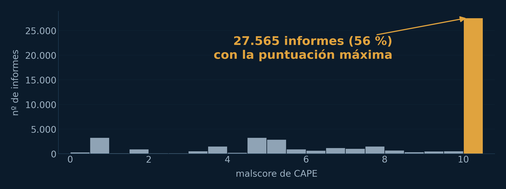
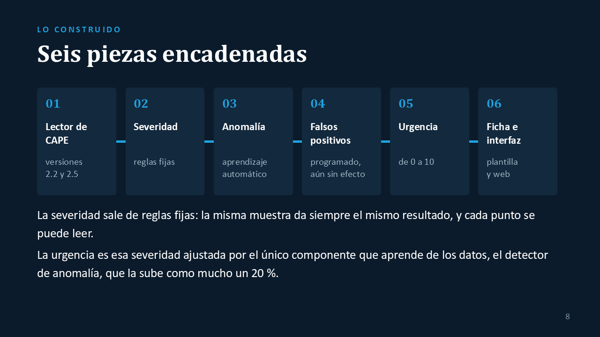
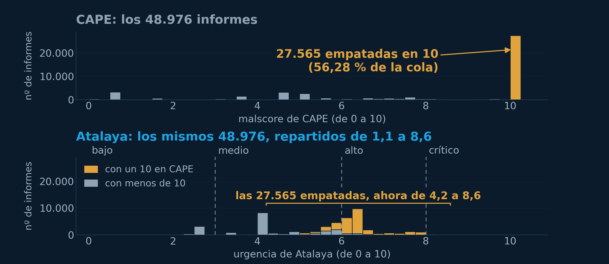
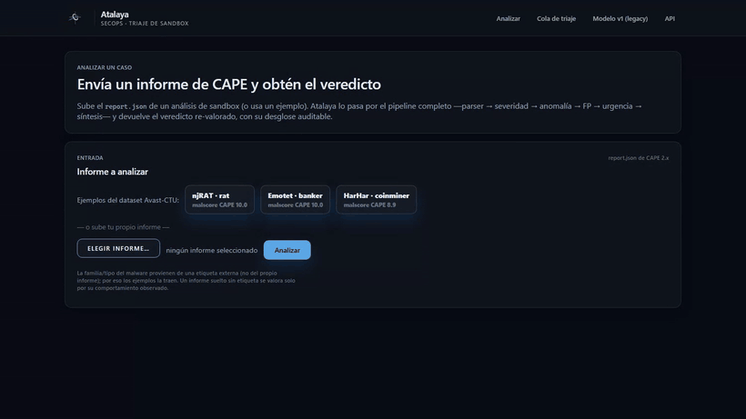
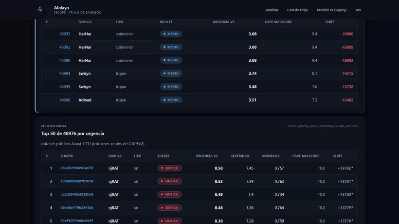

# Atalaya

**Asistente para re-valorizar los veredictos de un sandbox y priorizar incidentes en un SOC.**

Trabajo Fin de Grado del Grado en Ingeniería de Computadores, ETSISI (Universidad Politécnica de Madrid), septiembre de 2026. Calificación: **10**.
Autor: Iván de Diego Benítez. Tutor: Borja Bordel Sánchez.

[Memoria (PDF)](docs/Atalaya_memoria_TFG.pdf) · [Presentación de la defensa (PDF)](docs/Atalaya_presentacion_defensa.pdf) · [Vídeo de la demo (MP4)](media/atalaya_demo.mp4)

---

## El problema

Un centro de operaciones de seguridad (SOC) recibe más alertas de las que puede revisar. Cuando una alerta trae un fichero sospechoso, un sandbox como [CAPE](https://github.com/kevoreilly/CAPEv2) lo ejecuta en una máquina aislada y devuelve un informe con lo que ha hecho y una puntuación de riesgo de 0 a 10.

En 48.976 informes reales de CAPE (dataset público Avast-CTU), **27.565, el 56 %, tienen la puntuación máxima**. Empatados en el 10, esa puntuación ya no sirve para decidir qué alerta se mira primero.

## Qué hace Atalaya

Vuelve a puntuar cada informe **sin usar la puntuación de CAPE** y entrega una cola ordenada por urgencia en la que cada posición se puede explicar.

- **Severidad (0 a 10)** con reglas fijas que se pueden revisar: tipo de amenaza, firmas de CAPE, técnicas de ataque (MITRE ATT&CK) y notoriedad de la familia.
- **Anomalía**: un modelo sin etiquetas (IsolationForest) mide lo atípica que es la conducta de cada muestra y sube la urgencia como mucho un 20 %.
- **Ficha para el analista**: de dónde sale cada punto, las técnicas observadas y la acción recomendada.

## Resultados

Sobre los 48.976 informes:

| | Puntuación de CAPE | Atalaya |
|---|---:|---:|
| Informes en el nivel crítico (8 o más) | 29.809 | 364 |
| Informes empatados en el máximo | 27.565 | ordenados entre 4,2 y 8,6 |

- Separando familias de malware, la puntuación de CAPE va algo por delante (η² de 0,510 frente a 0,477). Lo que aporta Atalaya es el orden dentro del bloque que CAPE deja empatado.
- De 64 casos revisados a mano, 57 son coherentes, 7 tienen una salvedad explicada y ninguno carece de sentido.
- El orden apenas cambia al mover las constantes del motor o al corregir los dos defectos de calibración conocidos: la correlación con el orden original no baja de 0,9887.

## Demo

Un informe real de CAPE, analizado en el momento:

La cola ordenada: los primeros tienen todos un 10 en CAPE, y Atalaya los separa.

El recorrido completo, de 2:30, está en [media/atalaya_demo.mp4](media/atalaya_demo.mp4).

## Tecnologías

Python, FastAPI, scikit-learn, pandas, Jinja2 y pytest. Los informes proceden del sandbox CAPEv2. La ficha puede redactarse con una plantilla o con un modelo de lenguaje local (Ollama); la plantilla es el modo por defecto.

## Sobre este repositorio

Aquí están la memoria, la presentación y la demo del trabajo. El código del prototipo y los datos no se publican.

## Contacto

[LinkedIn](https://www.linkedin.com/in/ivan-de-diego-benitez-650a0b383)
